<p align="center">
  
</p>

<h1 align="center">Backup Box</h1>

<p align="center">
  <b>A pocket backup station for photographers.</b><br>
  Copy memory cards to an SSD on location, without a computer.<br>
  Control it from the box's display, any browser, or the Android app.
</p>

<p align="center">
  <a href="#install">Install</a> ·
  <a href="#original-vs-now">Original vs now</a> ·
  <a href="#the-app-view-touch-ui">App view</a> ·
  <a href="#oled-display-and-joystick">OLED</a> ·
  <a href="#android-app">Android app</a> ·
  <a href="CHANGELOG.md">Changelog</a>
</p>

---

Backup Box runs on a Raspberry Pi. You plug in a camera card and an SSD, and the box copies the photos and
videos, checks them, makes previews, and shows you what it has. It runs on its own in the field: it has its own
Wi-Fi hotspot, Bluetooth for the phone, a small OLED display with a joystick, and it never needs internet.

This project builds on **[Little Backup Box](https://github.com/outdoorbits/little-backup-box)** by Stefan Saam
(outdoorbits). Its proven backup engine (rsync, cameras over gPhoto2, cloud targets with rclone, databases,
EXIF, thumbnails) is still at the heart of the box. This repository adds:
- a new interface on every screen, from the 1.3" OLED to phones and desktops;
- an Android app with Bluetooth;
- copy-only safety;
- power saving;
- many fixes found on a Raspberry Pi 5.

## Highlights

- **App view (touch UI):** one interface for the box's touchscreen, phones and tablets.
  - Start a backup in two taps.
  - See the latest photos and browse every drive.
  - Manage drives: check, repair, format, thumbnails, database, EXIF.
  - Wi-Fi settings and a sage theme.
- **Full web interface:** the original pages, redesigned and tidy at every width. The gallery works like the app's.
- **OLED display with joystick:**
  - a home screen with the backup drive's fill level;
  - a graphic menu (start, choose source and target, status, network, power);
  - backup progress with a real progress bar;
  - it sleeps when idle.
- **Android app:**
  - finds the box nearby over Bluetooth and pairs it like headphones;
  - shows its state and starts or stops a backup;
  - opens the touch UI over Wi-Fi, joining the box's hotspot by itself;
  - downloads photos into the phone's gallery.
- **Copy only from the box's buttons and the app:** a button press never deletes anything on the card.
- **Field-ready networking:**
  - the box's hotspot works without forced sign-in pages;
  - the box's address opens the app if it is installed.
- **Power and heat:**
  - lighter background jobs;
  - a display that sleeps;
  - under-voltage shown at once.
- **Faster previews:** thumbnails from the camera's embedded previews, several at a time; videos get a frame.

## Original vs now

**Start page in a browser**

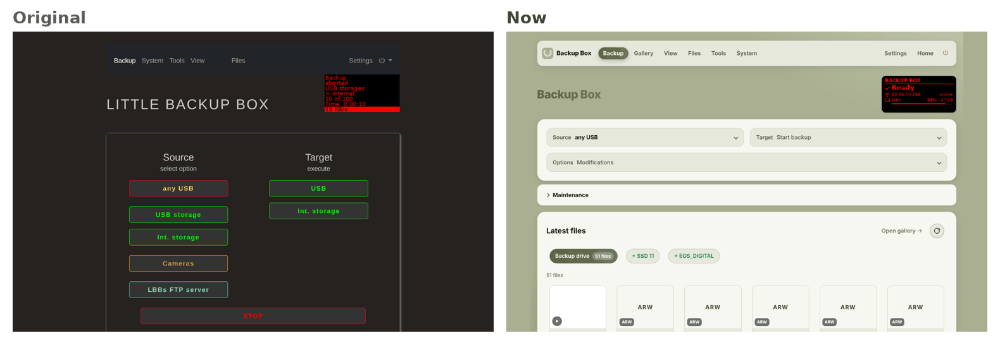

**On a phone:** the original page and the new app view

<p align="center">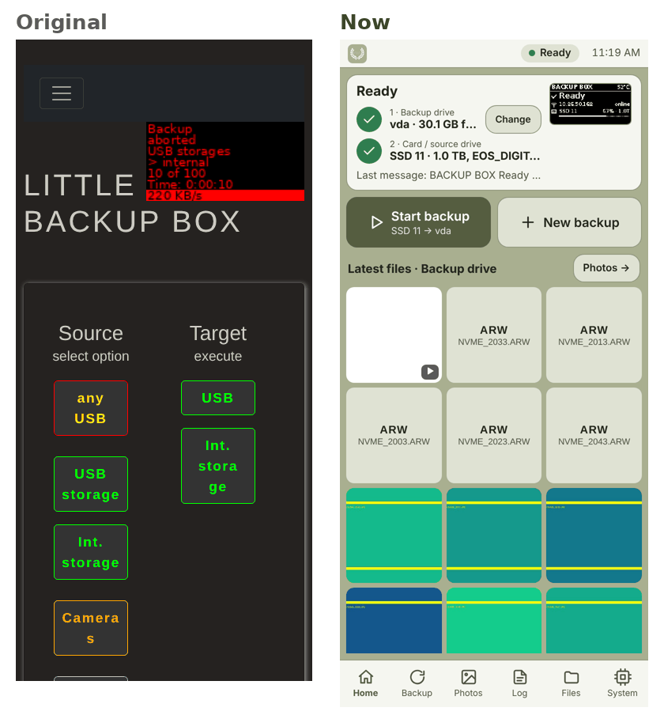</p>

**Gallery**

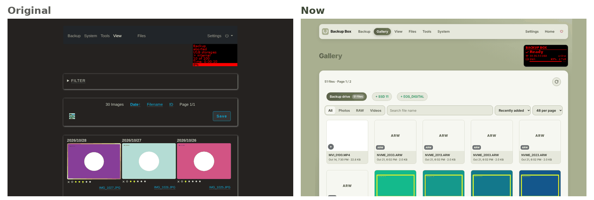

**OLED display:** the same moments, drawn by the box's old and new display code

<p align="center">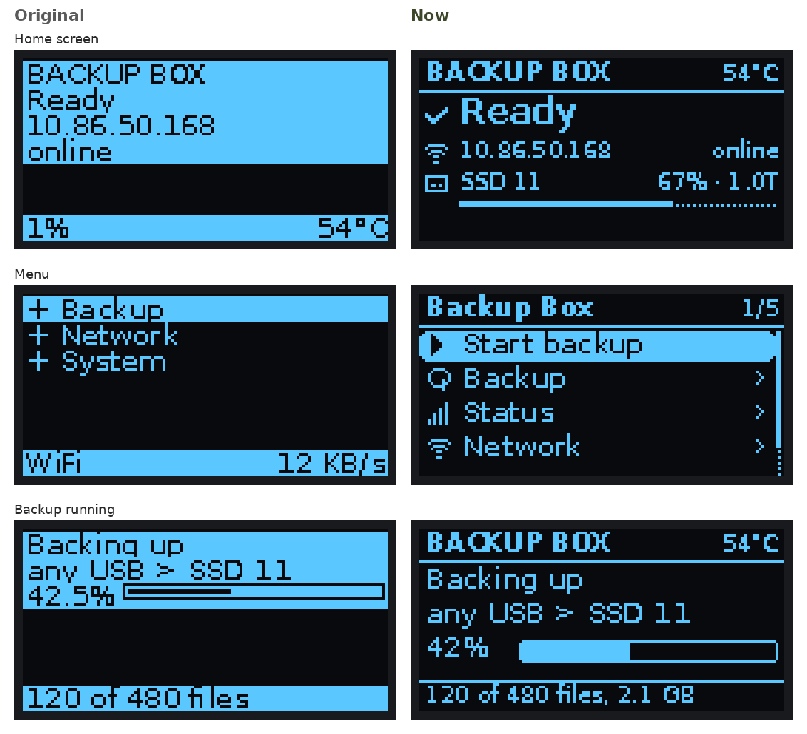</p>

## The app view (touch UI)

It is made for fingers: on the box's own touchscreen, on phones and in the Android app. Open the box's address
(`http://<box>/`) and you are there. The full web interface is one tap away.

| Home | Photos | Files | Backup |
|:---:|:---:|:---:|:---:|
| 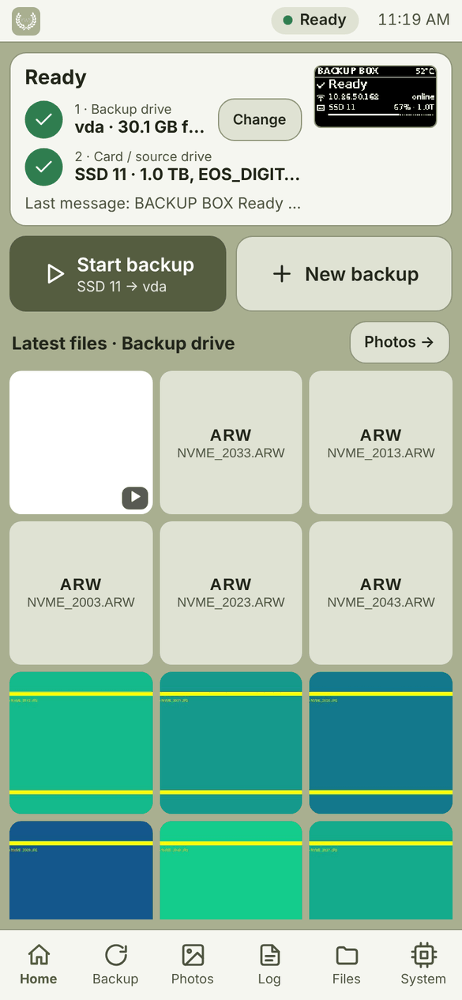 | 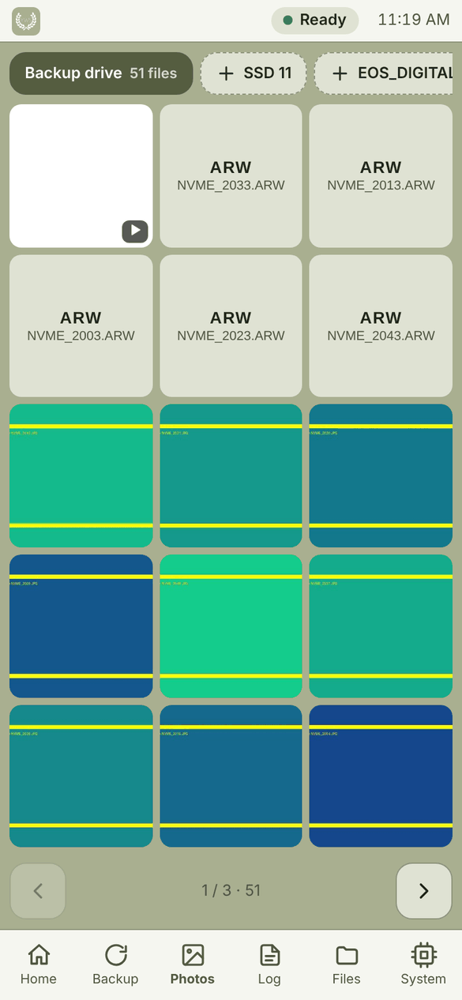 | 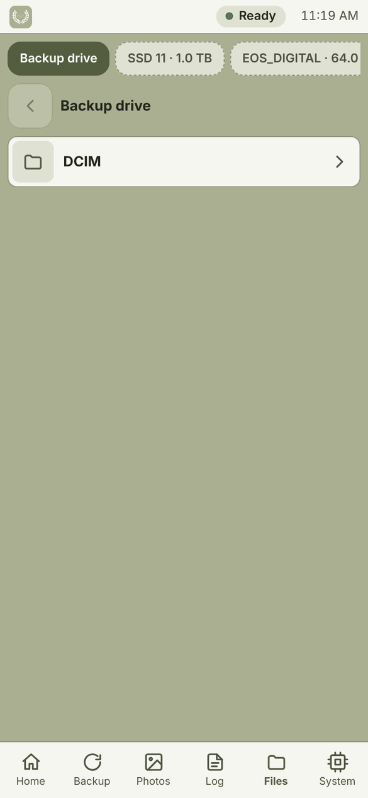 | 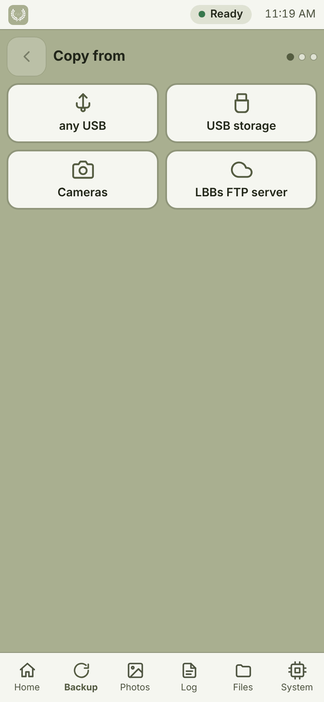 |
| **Ready at a glance:** backup drive, source, the OLED mirrored, the latest files | **Latest files from every drive:** photos, RAW, videos, newest first, full-screen viewer with download | **Browse any drive:** long-press to select, rename or delete | **Choose source and target**, options, live progress |

| System | One drive | Wi-Fi |
|:---:|:---:|:---:|
| 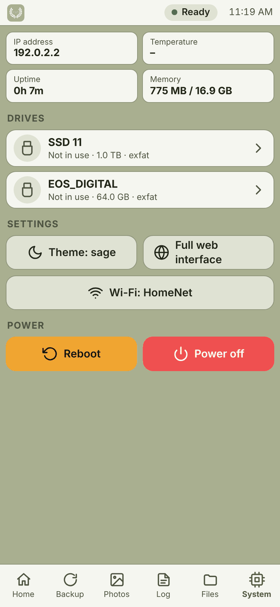 | 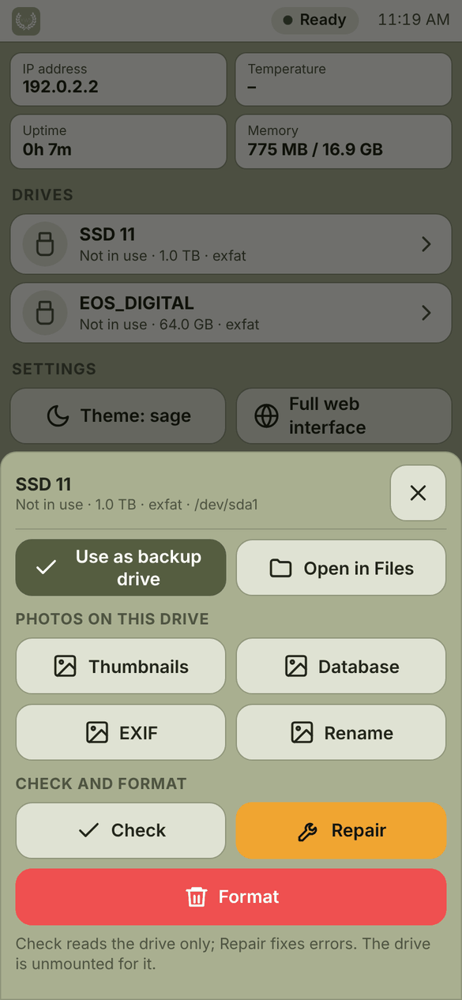 | 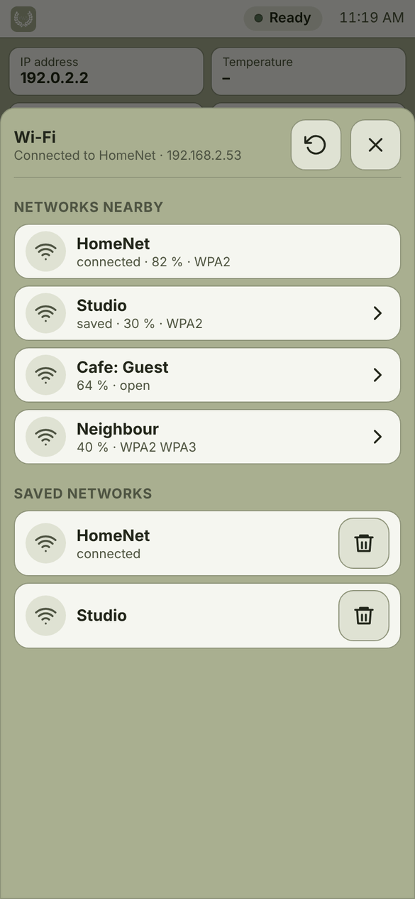 |
| **The box:** address, temperature, drives, theme, update, power | **Per drive:** use as backup drive, open, thumbnails, database, EXIF, rename, check, repair, format (asks twice) | **Networks nearby:** connect, forget saved ones; in hotspot mode the box's Wi-Fi setup |

**On the box's own 480×320 touchscreen**

| Home | Photos | System |
|:---:|:---:|:---:|
| 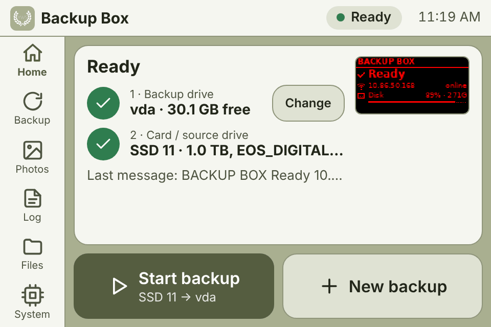 | 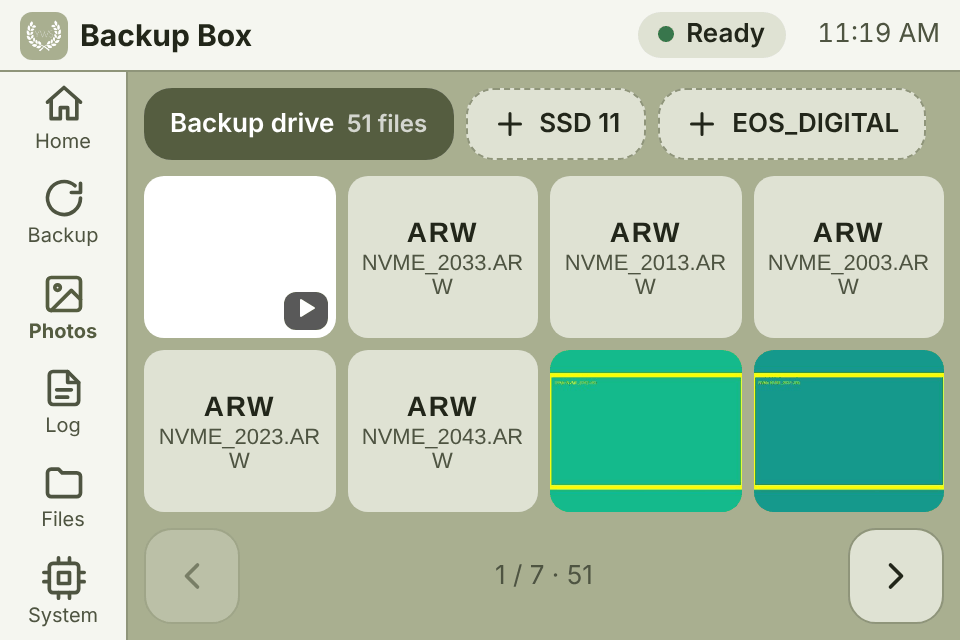 | 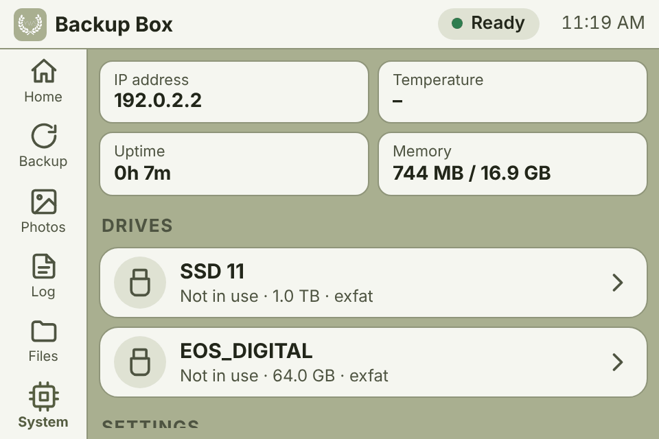 |

Themes: dark, light, sepia and **sage**. Under-voltage (a weak power supply) shows as a pill in the top bar,
and a tap explains it.

## Full web interface

All the original pages: backup, gallery, files, tools, settings and system, now with a tidy layout from phone to
desktop. The source and target pickers are compact, there's a maintenance table per drive, and the gallery
works like the app's.

| Backup | Gallery | Settings |
|:---:|:---:|:---:|
| 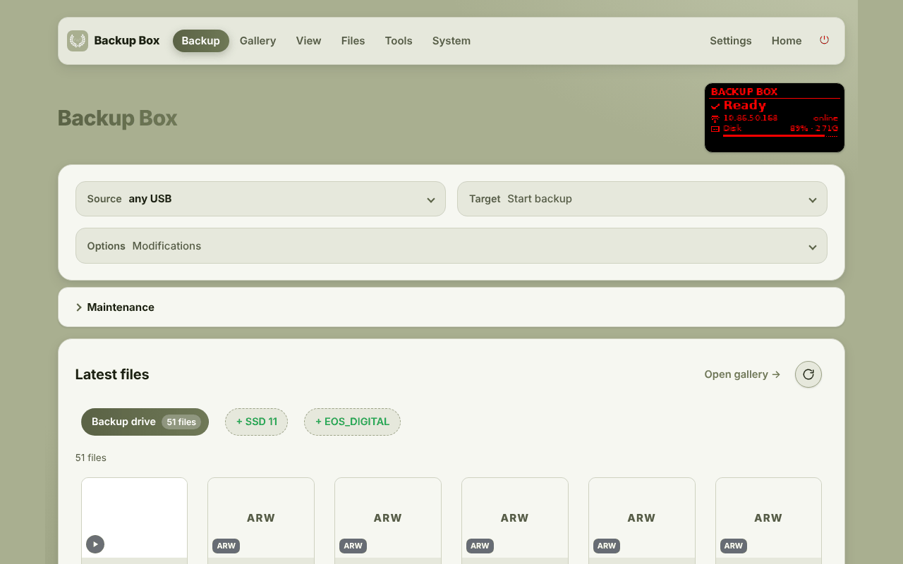 | 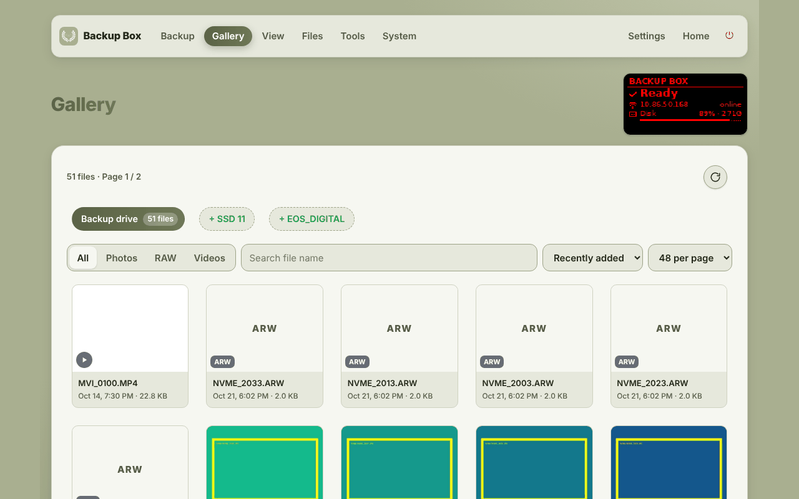 | 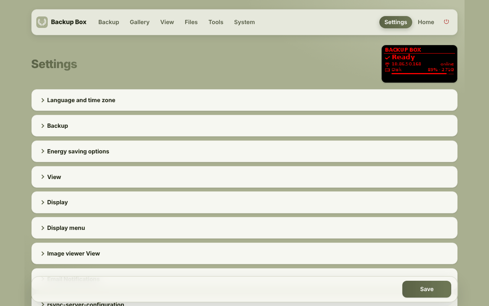 |

## OLED display and joystick

Made for the **Waveshare 1.3" OLED HAT** (SH1106, 128×64), and it also works on other displays the box supports.

<p align="center">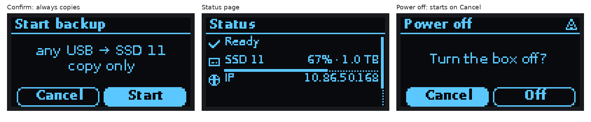</p>

- **Home screen:**
  - state, IP address and online state, temperature;
  - the backup drive with its fill and size, also while it is not mounted (read without mounting it).
- **Messages** (comitup, backup progress, power off and so on) use the same title bar.
  - QR codes for the address and the Wi-Fi stay full screen so phones can scan them.
  - The home screen comes back by itself: 8 s after a message, 60 s after a backup so you can read the result, never while a backup runs.
- **Menu** (any joystick direction opens it):
  - **Start backup:** the default backup, copy only, with a confirm screen.
  - **Backup:** choose a source, then a target.
  - **Stop backup:** only while one runs.
  - **Status:** state, drives with fill, IP, temperature, power supply.
  - **Network:** IP QR, Wi-Fi QR, reset Wi-Fi.
  - **Power:** display off, reboot, power off. Risky actions start on *Cancel*.
- **Joystick:**
  - up and down to move (hold to scroll);
  - right or press to select;
  - left to go back, hold left to close;
  - the menu closes after 15 s.
- **Display sleep** after 10 idle minutes (Settings → Display); the first press only wakes it.
- **Boot:** your logo, the IP QR code once, then the home screen.

## Android app

**Download:** [BackupBox.apk](https://github.com/keeratsawhney/backupbox/releases/download/android/BackupBox.apk)
(built by GitHub on every change, see [android/](android/)).

- **Pair a nearby box** through Android's own device popup, like earbuds. Type the 6-digit code shown on the OLED.
- **Status card over Bluetooth**, with no Wi-Fi needed:
  - Ready or backup running, with what the OLED shows;
  - drive fill and size;
  - **Start backup** (copy only), **Stop**, **Power off**.
- **Open box:** the touch UI over Wi-Fi.
  - The app finds the box on your current network, or joins the box's hotspot by itself (Android asks once).
  - Your phone keeps mobile data for everything else.
  - Previews and downloads always go over Wi-Fi, which is fast.
- **Finds boxes** on the Wi-Fi or at the hotspot address (`10.41.0.1`), or by address.
- **Security:**
  - HTTPS with the box's own certificate, trusted the first time and pinned;
  - a changed certificate is reported;
  - the box's password is remembered.
- **Downloads** go to *Pictures / Movies › Backup Box*.
- **Links:** the box's address or its QR code opens the app if it is installed, otherwise the browser.

Signing: the repository is public, so the app's signing key is **never committed**. GitHub reads it from
repository secrets (`ANDROID_KEYSTORE_BASE64`, `ANDROID_KEYSTORE_PASSWORD`, `ANDROID_KEY_ALIAS`,
`ANDROID_KEY_PASSWORD`). Without them, builds are signed with a temporary debug key.

## Networking in the field

- **Hotspot without a sign-in trap:** phones see "no internet" and stay connected; `http://10.41.0.1` opens the box.
- **Wi-Fi setup:** in the app (System › Wi-Fi), or comitup's page at `/comitup/`.
- **Bluetooth Low Energy** carries only state and commands; files always go over Wi-Fi.

## Safety

- Backups started from the **OLED menu or the Android app's Bluetooth card always copy**: nothing is deleted from
  the card. Moving files has to be chosen on purpose: in the web interfaces' backup options, or for the default
  backup at boot in Settings (off unless you switch it on).
- Formatting a drive asks twice. Risky menu actions start on *Cancel*.
- The Wi-Fi password and the box's commands over Bluetooth need pairing with the code on the box's display.
- The installer no longer prints the box's TLS private key.

## Power and heat

- **The display loop no longer starts processes every couple of seconds.** It caches the Wi-Fi state and skips redrawing unchanged frames.
- **The IP job runs much lighter:** no QR code every minute, mail checks only when IP mails are set up.
- **The display sleeps** after idle minutes (configurable).
- **Browser pages poll less:** every 5 s instead of 2 s when idle, and not at all in background tabs.
- **Fewer thumbnail workers** when the power supply is weak (under-voltage) or memory is low.

## Hardware

Developed and tested on:
- Raspberry Pi 5;
- Waveshare 1.3" OLED HAT (SH1106, joystick);
- a USB SSD (exFAT) as backup drive;
- a USB-C PD power supply.

Other Little Backup Box hardware (other displays, Raspberry Pi models, touchscreens) keeps working.

## Install

1. Flash **Raspberry Pi OS (Trixie)**, Lite is fine, with Raspberry Pi Imager. Enable SSH and set a user and password.
2. Connect the Pi to the internet and log in over SSH.
3. Run:
   ```bash
   branch='main'; curl -sSL https://raw.githubusercontent.com/keeratsawhney/backupbox/${branch}/install-little-backup-box.sh | bash -s -- ${branch} 2> install-error.log
   ```
   The installer asks for the default backup (started after boot) and whether to install comitup (the box's own Wi-Fi hotspot).

### Update

Use the **Update** button (app view › System, or the full web interface), or run this on the box:
```bash
cd ~ && rm -rf backupbox && git clone --depth 1 --branch main https://github.com/keeratsawhney/backupbox.git && cd backupbox && ./install-touch-ui.sh
sudo reboot
```

### Checks

```bash
./touch-selftest.sh                          # web UI, display, drives
systemctl status lbb-ble --no-pager          # Bluetooth for the app
journalctl -u lbb-ble --no-pager | tail -30
```

## Changelog

Every change went in through a pull request with its own description. See **[CHANGELOG.md](CHANGELOG.md)**.

## Credits and license

Based on [Little Backup Box](https://github.com/outdoorbits/little-backup-box) by Stefan Saam and its
contributors; their wiki covers the backup engine, cloud services and hardware in depth. Hotspot and Wi-Fi setup
by [comitup](https://davesteele.github.io/comitup/).

Licensed under the **GNU General Public License v3.0**, see [LICENSE](LICENSE).
